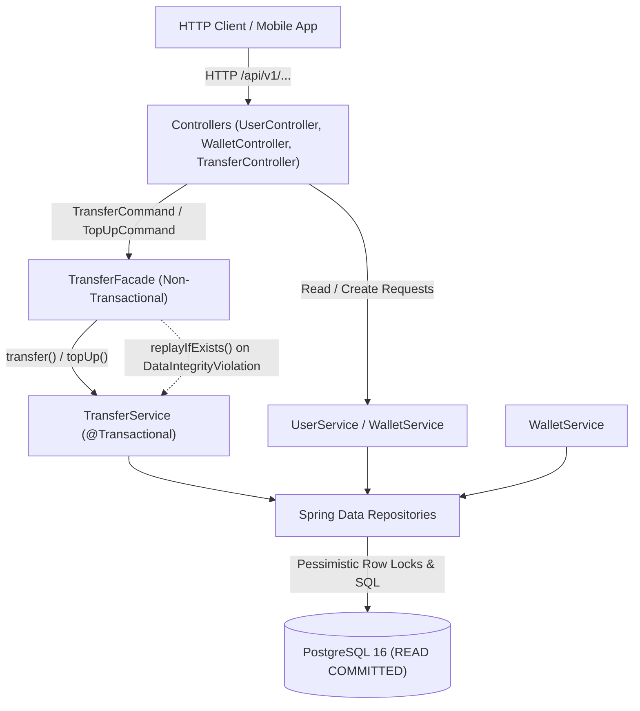
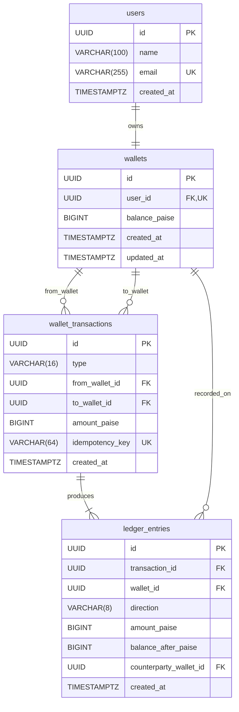

# P2P Wallet Service

A high-performance, concurrency-safe Peer-to-Peer (P2P) digital wallet service built with Spring Boot 3.3.5, Java 21, and PostgreSQL 16.

---

## 1. Overview

The **P2P Wallet Service** provides an audit-compliant, robust balance and ledger management engine supporting user creation, wallet top-ups, peer-to-peer money transfers, and paginated audit transaction histories.

### Key Features
- **User & Wallet Creation**: Creates a user profile with an associated digital wallet initialized to 0 paise balance.
- **Balance Lookup**: Fast, non-locking read of current wallet balances.
- **Wallet Top-Up**: Idempotent balance loading directly into user wallets.
- **P2P Transfers**: Atomic money movement between accounts with ordered pessimistic row locking.
- **Transaction History**: Paginated, chronological ledger and transaction history (newest-first) detailing transfer counterparties and point-in-time balance snapshots.

### Tech Stack
- **Language**: Java 21
- **Framework**: Spring Boot 3.3.5 (Web, Spring Data JPA, Validation, Actuator)
- **Database**: PostgreSQL 16 (default `READ COMMITTED` isolation)
- **Schema Migrations**: Flyway
- **Testing**: JUnit 5, AssertJ, Spring Boot Test, Testcontainers (PostgreSQL 16)
- **Containerization**: Docker (multi-stage build), Docker Compose

### Core Guarantees
- **Conservation of Money**: Money is neither created nor destroyed during transfers. The total funds across all wallets remain invariant under high concurrent load.
- **Non-Negative Balances**: Balances cannot drop below zero, even under heavy concurrent overdraft attempts.
- **Deadlock-Free Execution**: Global ordering of row locks eliminates lock cycles, ensuring concurrent opposing transfers (A &rarr; B and B &rarr; A) execute without deadlocks.
- **Strict Idempotency**: Every mutating operation requires an `Idempotency-Key`. Concurrent or sequential replays with the same key execute logic exactly once, returning the original response without double-spending.

---

## 2. Architecture



### Layering Rules
- **Non-Transactional Web & Facade**: Controllers and `TransferFacade` are strictly non-transactional (`spring.jpa.open-in-view=false`).
- **Facade Responsibilities**: `TransferFacade` coordinates calls to `TransferService` and gracefully catches unique constraint violations (`uq_wallet_transactions_idempotency_key`), fetching the committed winner's result via `replayIfExists(...)`.
- **Service Transaction Boundary**: `TransferService` owns the database transaction (`@Transactional`), enforcing row lock ordering, funds checks, balance mutations, and ledger entries within a single atomic commit.

---

## 3. Database Schema

The database follows double-entry bookkeeping principles. Every transfer generates a transaction row and two ledger entries (DEBIT sender, CREDIT receiver). Top-ups generate a transaction row and one credit ledger entry.



### Schema Guarantees
- **Hibernate UUID Generation**: UUIDs are generated by Hibernate (`GenerationType.UUID`).
- **Immutable Historical Records**: Only committed, successful operations persist rows in `wallet_transactions` and `ledger_entries`. Rejected operations roll back completely.
- **Integrity Constraints**:
  - `ck_wallets_balance_non_negative`: `CHECK (balance_paise >= 0)`
  - `uq_wallet_transactions_idempotency_key`: `UNIQUE (idempotency_key)`
  - `ck_wallet_transactions_shape`: Validates `TOPUP` has null sender and `TRANSFER` has distinct sender and recipient wallets.
  - `ck_ledger_amount_positive` & `ck_ledger_balance_non_negative`.

---

## 4. Concurrency Design

### The Problem
When two debits on the same wallet execute concurrently (e.g. balance is 100 paise; Thread 1 debits 80, Thread 2 debits 50), both threads could read balance = 100 concurrently. Both pass validation and compute updated balances (20 and 50), resulting in a lost update and an illegal overdraft.

### The Solution: Pessimistic Row Locking
Inside a single database transaction under PostgreSQL default `READ COMMITTED` isolation, the service executes `SELECT ... FOR UPDATE` via `walletRepository.findByIdForUpdate(id)`. This blocks concurrent transactions attempting to read/lock the same wallet rows until the holder commits or rolls back.

### Globally Ordered Lock Acquisition
When transferring funds between two wallets, locking them in arbitrary order creates lock inversion deadlocks (e.g. Thread 1 locks A then waits for B; Thread 2 locks B then waits for A).

To prevent deadlocks, `TransferService` determines lock ordering using UUID natural ordering:
```java
UUID firstId  = fromWalletId.compareTo(toWalletId) < 0 ? fromWalletId : toWalletId;
UUID secondId = firstId.equals(fromWalletId) ? toWalletId : fromWalletId;

Wallet first  = lockWallet(firstId);
Wallet second = lockWallet(secondId);

Wallet from = firstId.equals(fromWalletId) ? first : second;
Wallet to   = (from == first) ? second : first;
```
Because every transaction in the system acquires wallet locks in the identical order, a lock cycle is mathematically impossible.

### Why Pessimistic Over Optimistic Locking?
Wallets are hot database rows. Optimistic locking (`@Version`) would cause high abort and retry rates under contention, wasting CPU and database bandwidth. Money movements should be deterministic and sequential without relying on blind retry loops.

### Alternative Considered
An atomic single-statement update such as:
```sql
UPDATE wallets SET balance = balance - :amt WHERE id = :id AND balance >= :amt;
```
While atomic, explicitly locking both rows allows point-in-time snapshotting of both source and destination balances for accurate double-entry ledger entries within the same transaction.

---

## 5. Idempotency

Mutating endpoints (`POST /wallets/{userId}/topup`, `POST /transfers`) require an `Idempotency-Key` header matching `^[A-Za-z0-9_-]{8,64}$`.

### Idempotency Flow
1. **Pre-Lock Fast Path**: Check if `idempotencyKey` already exists. If found, verify parameters match and immediately return the stored result with `200 OK` and header `Idempotent-Replay: true`.
2. **Lock Acquisition**: Acquire row locks in globally consistent order.
3. **Post-Lock Double-Check**: Re-query `findByIdempotencyKey` after acquiring locks. If another concurrent request with the same key raced and committed while this thread was blocked waiting for locks, the fresh snapshot in `READ COMMITTED` reveals the committed transaction, triggering an immediate idempotent replay.
4. **Flush & Facade Fallback**: `saveAndFlush()` flushes the transaction record. If two concurrent requests with identical keys targeted different wallets, the database `uq_wallet_transactions_idempotency_key` unique constraint throws a `DataIntegrityViolationException`. `TransferFacade` catches this and safely fetches the committed winner's result.
5. **Payload Mismatch**: If an idempotency key is reused with different parameters (amount, sender, or receiver), the system throws `IdempotencyKeyReusedException` (HTTP `422 IDEMPOTENCY_KEY_REUSED`).

---

## 6. Ledger and Money Model

- **Paise as Long**: All monetary amounts are represented as 64-bit integer paise (`long`). Floating-point types (`float`, `double`, `BigDecimal`) are forbidden to eliminate rounding errors.
- **Double-Entry Ledger**:
  - `TRANSFER`: 1 DEBIT row on sender wallet + 1 CREDIT row on recipient wallet.
  - `TOPUP`: 1 CREDIT row on recipient wallet (counterparty is null).
- **Audit Invariant**: At any time, a wallet's current balance equals the sum of its credit ledger entries minus the sum of its debit ledger entries:
  $$\text{balance} = \sum \text{CREDIT} - \sum \text{DEBIT}$$
- **Atomic Rollback**: If funds are insufficient or any failure occurs, the transaction rolls back completely. No transaction records or ledger entries are written, and the idempotency key remains unconsumed.

---

## 7. API Reference

Base path: `/api/v1`

| Method | Endpoint | Description | Status Codes |
|---|---|---|---|
| `POST` | `/api/v1/users` | Create user and initial wallet | `201`, `400`, `409` |
| `GET` | `/api/v1/wallets/{userId}` | Get wallet balance | `200`, `400`, `404` |
| `POST` | `/api/v1/wallets/{userId}/topup` | Top up wallet balance | `201`, `200` (replay), `400`, `404`, `422` |
| `POST` | `/api/v1/transfers` | Transfer paise between users | `201`, `200` (replay), `400`, `404`, `422` |
| `GET` | `/api/v1/wallets/{userId}/transactions` | Paginated transaction history | `200`, `400`, `404` |
| `GET` | `/actuator/health` | Service health status | `200` |

### cURL Examples

#### 1. Create User
```bash
curl -i -X POST http://localhost:8080/api/v1/users \
  -H "Content-Type: application/json" \
  -d '{"name": "Asha", "email": "asha@example.com"}'
```

#### 2. Top Up Wallet
```bash
curl -i -X POST http://localhost:8080/api/v1/wallets/<USER_ID>/topup \
  -H "Content-Type: application/json" \
  -H "Idempotency-Key: topup-key-00000001" \
  -d '{"amountPaise": 500000}'
```

#### 3. Idempotent Replay of Top Up
```bash
curl -i -X POST http://localhost:8080/api/v1/wallets/<USER_ID>/topup \
  -H "Content-Type: application/json" \
  -H "Idempotency-Key: topup-key-00000001" \
  -d '{"amountPaise": 500000}'
```
*Response Header contains `Idempotent-Replay: true` with status `200 OK`.*

#### 4. Transfer Money
```bash
curl -i -X POST http://localhost:8080/api/v1/transfers \
  -H "Content-Type: application/json" \
  -H "Idempotency-Key: transfer-key-00000001" \
  -d '{"fromUserId": "<SENDER_UUID>", "toUserId": "<RECEIVER_UUID>", "amountPaise": 25000}'
```

#### 5. Get Wallet Balance
```bash
curl -i -X GET http://localhost:8080/api/v1/wallets/<USER_ID>
```

#### 6. Get Transaction History
```bash
curl -i -X GET "http://localhost:8080/api/v1/wallets/<USER_ID>/transactions?page=0&size=20"
```

---

## 8. Running the Application

### Using Docker Compose
Run the application and PostgreSQL database with a single command:
```bash
docker compose up --build
```
Verify the service is running:
```bash
curl http://localhost:8080/actuator/health
# {"status":"UP"}
```

### Running Tests
Run the entire suite of integration and concurrency tests:
```bash
mvn test
```
*(Requires Docker to be running locally for Testcontainers).*

---

## 9. Test Strategy

| Test Suite | Scenario | What It Proves |
|---|---|---|
| `ConcurrentTransferTest` | `randomConcurrentTransfersConserveMoney` | 200 transfers across 32 concurrent threads on 10 users: proves conservation of money, non-negative balances, ledger-to-balance equality, and absence of deadlocks. |
| `ConcurrentTransferTest` | `bidirectionalTransfersDoNotDeadlock` | 100 simultaneous bidirectional transfers (A&rarr;B and B&rarr;A): proves ordered locking prevents cycles. |
| `ConcurrentTransferTest` | `overdraftRaceNeverGoesNegative` | 20 concurrent threads attempting to overdraw a wallet funded with only 10 transfers: exactly 10 succeed, 10 fail with `InsufficientFundsException`, ending at balance 0. |
| `IdempotencyTest` | `sameKeyConcurrentReplayMovesMoneyOnce` | 20 concurrent threads submitting identical transfer requests: exactly 1 executes, 19 replay, money moves exactly once. |
| `IdempotencyTest` | `sameKeyDifferentPayloadIsRejected` | Reusing a key with a different amount throws `IdempotencyKeyReusedException` without modifying balances. |
| `IdempotencyTest` | `topUpIsIdempotent` | Concurrent duplicate top-ups increment balance exactly once. |
| `TransferValidationTest` | Validation suite | Validates self-transfers, invalid amounts, non-existent users, and unconsumed idempotency keys after failed attempts. |
| `HistoryTest` | Ledger ordering & pagination | Validates newest-first chronological ordering, balance snapshots, counterparties, and pagination boundaries. |
| `ApiSmokeTest` | End-to-end HTTP suite | Validates full HTTP request/response lifecycles, JSON serialization, headers (`Idempotent-Replay`), and custom error codes. |

---

## 10. Limitations and Future Work

1. **Idempotency Key Scoping & TTL**: Current idempotency keys are table-wide unique. In production, scoping keys per user (`user_id + idempotency_key`) and implementing a TTL-based retention policy (e.g. 24-48 hours) would manage table growth.
2. **Lock Timeouts**: Setting explicit lock acquisition timeouts (`SET lock_timeout = '2s'`) protects against long-running database hold-ups.
3. **Transactional Outbox & Event Publishing**: Emitting domain events (`TransferCompleted`, `TopUpCompleted`) via a transactional outbox table for downstream asynchronous systems (Kafka, notifications).
4. **Rate Limiting**: Defending public API endpoints against burst denial-of-service attempts via token bucket algorithms (e.g. Bucket4j or Redis).
5. **Automated Reconciliation**: Scheduled background reconciliation jobs verifying ledger sums against current wallet balances across all accounts.
6. **Authentication & Multi-Currency**: Adding OAuth2/JWT token verification, user authorization checks, and multi-currency exchange conversion rates.

---

## 11. UI (Wallet Console)

A utilitarian operator console for the wallet API, designed in the spirit of an internal banking ledger book.

### Running the Web UI

#### With Docker Compose:
The web console is built into the compose stack and served on port 3000:
```bash
docker compose up --build
```
Open **http://localhost:3000** in your browser.

#### Local Development:
```bash
cd frontend
npm install
npm run dev
```
The Vite development server runs on `http://localhost:5173` and proxies `/api` and `/actuator` requests to `http://localhost:8080`.

### Features
- **Account Directory**: Local directory in `localStorage` allowing operators to switch between accounts without credentials.
- **Transfers & Top-Ups**: Send funds and add money with integer paise parsing, live amount validation, and visible `Idempotency-Key` lifecycle handling with safe retry on network failures.
- **Double-Entry Ledger**: Paginated, chronological transaction ledger with counterparty names, direction markers (`+` credit / `−` debit), and balance after snapshot.
- **Request Dock**: Collapsible bottom dock logging all API requests with timing, payloads, headers, and an interactive "Replay" action.
- **Concurrency Lab (`/lab`)**: Live interactive testbed demonstrating concurrent transfer execution, conservation of money invariance, and same-key deduplication.


